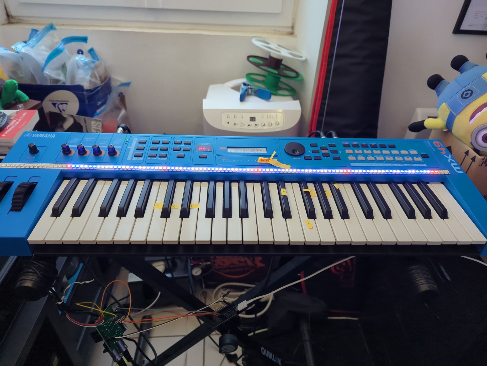
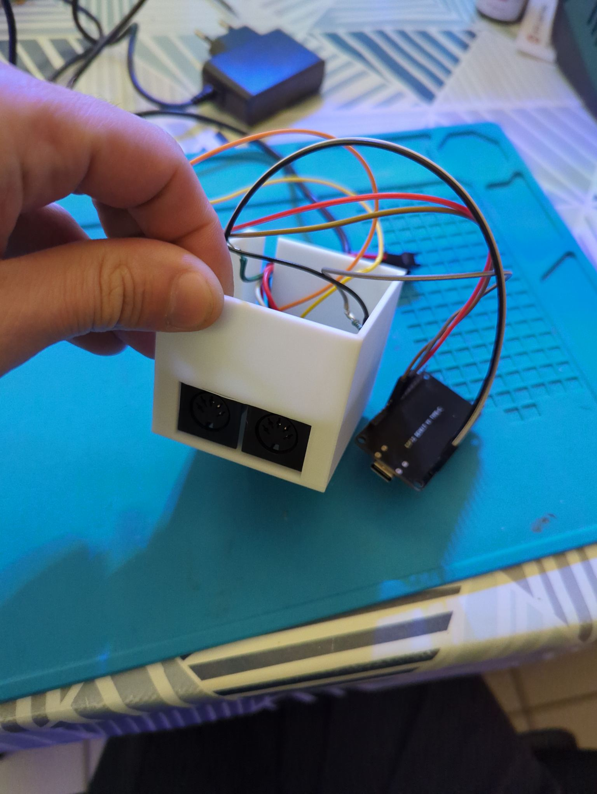
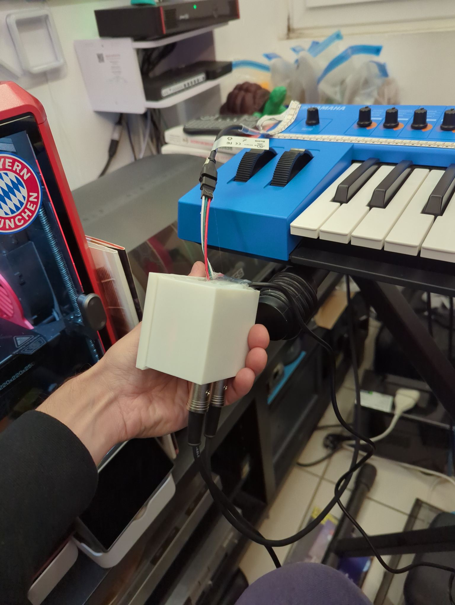

# Piano LED — les touches s'allument, il n'y a plus qu'à jouer

*Bandeau LED d'apprentissage du piano pour Yamaha MX49, piloté par un ESP32.*

Un ESP32 pilote un bandeau WS2812B posé au-dessus du clavier et allume les touches à jouer. On envoie un fichier MIDI depuis son téléphone ou son ordinateur, on choisit la vitesse et la main à travailler, et le bandeau montre quelles touches enfoncer. Le MX49 peut jouer le morceau lui-même, ou attendre qu'on joue la bonne note.



| | |
|---|---|
|  |  |

**État : phase 2.** Lecture de fichiers MIDI depuis une interface web, modes démo et attente. Les commandes série de la phase 1 restent disponibles pour la maintenance.

## Câblage

| Élément | Détail |
|---|---|
| Microcontrôleur | ESP32 DevKit V1 (ESP32-WROOM-32, 4 Mo, 30 broches) |
| Bandeau | WS2812B 5 V, 144 LED/m (pas de 6,944 mm), ordre GRB |
| Alimentation | 5 V 3 A commune au bandeau et à l'ESP32 (VIN), masse commune |
| Adaptateur de niveau | SN74AHCT125N (3,3 V → 5 V) |
| MIDI | clone du SparkFun MIDI Shield (6N138), alimenté en 5 V |
| Clavier | Yamaha MX49, 49 touches, MIDI DIN |

| GPIO | Marquage | Rôle |
|---|---|---|
| 4 | D4 | données du bandeau (74AHCT125 canal 1 + 220 Ω) |
| 16 | RX2 | MIDI IN (pont diviseur 1 kΩ / 2,2 kΩ) |
| 17 | TX2 | MIDI OUT (74AHCT125 canal 2) |

- MIDI : UART2, 31 250 bauds, 8N1, signal non inversé.
- RX0/TX0 sont réservés à l'USB (moniteur série à 115 200 bauds).

Le boîtier (boîte + couvercle, fichiers STL à imprimer) est dans [`boitier/`](boitier/).

> ⚠️ **Débranche le fil VIN de l'ESP32 avant de brancher l'USB** pour programmer, afin de protéger le port USB du PC. Le bandeau peut rester sur l'alimentation 5 V à condition que les masses restent communes.

## Compilation et téléversement

PlatformIO avec le framework Arduino. Les versions sont figées dans `platformio.ini` : espressif32 6.10.0 (cœur Arduino 2.0.17), FastLED 3.9.16 et MIDI Library 5.0.2.

- Ne pas passer à FastLED 3.10 avec le cœur 3.x : ce couple donnait des couleurs fausses au hasard.
- Le téléversement se fait à 115 200 bauds, car la liaison USB lâche parfois à 460 800. Si un téléversement échoue, relance-le.

Avant la première compilation, remplis `src/secrets.h` : nom et mot de passe du Wi-Fi, mot de passe du point d'accès de secours. Ce fichier n'est pas versionné ; le modèle est `src/secrets.example.h`.

```sh
pio test -e native           # tests de l'analyseur MIDI sur le Mac
pio run                      # compiler
pio device list              # trouver le port
pio run -t upload            # téléverser
pio device monitor           # moniteur série (écho local, Entrée envoie la ligne)
```

## Correspondance note → LED

```
pos_mm(i) = offset_mm + i * pas_note_mm      (i = 0..48, touche 0 = la plus à gauche)
led(i)    = round(pos_mm(i) / 6.944)         (inversé si sens_inverse : nb_leds - 1 - led)
```

Avec `leds_par_note = 2`, le programme allume aussi la LED voisine du côté où tombe le centre de la note.

Noms des notes : 60 = do4 (convention scientifique), donc 36 = do2.

## Réglages (sauvegardés en NVS)

| Réglage | Défaut | Commande |
|---|---|---|
| `offset_mm` | 0 | `offset X` |
| `pas_note_mm` | 13.333 | `pas X` |
| `nb_leds` | 144 | `nbleds X` |
| `sens_inverse` | 0 | `inverse 0\|1` |
| `note_basse` | 36 | `basse` ou `basse N` |
| `luminosite` | 60 | `lum X` |
| `leds_par_note` | 1 | `ledsparnote 1\|2` |

L'ordre des couleurs (GRB) est fixé à la compilation, dans `src/bandeau.cpp`. La consommation est plafonnée à 2,5 A par FastLED.

## Réglages trouvés au premier essai

| Réglage | Valeur | Remarque |
|---|---|---|
| `sens_inverse` | 0 | entrée DIN du bandeau à gauche |
| `offset_mm` | 277.78 | 40 LED : premier do sur la LED 40, dernier sur la LED 132 |
| `note_basse` | 48 | MX49 transposé d'une octave vers le haut (sans transposition : 36). À refaire avec `basse` si la transposition change |
| `luminosite` | 30 | |
| `nb_leds` | 137 | bandeau coupé 4 LED après le dernier do (LED 0 à 136) |
| `leds_par_note` | 2 | plus visible ; en aperçu, des notes voisines se partagent parfois une LED |

## MIDI OUT : « MIDI data error » sur le MX49

Pendant le démarrage de l'ESP32, avant que le firmware tourne, la broche TX2 (GPIO17) flotte pendant environ 0,3 s. Le MX49 peut alors afficher « MIDI data error » une fois, à la mise sous tension ou à l'ouverture du moniteur série. L'envoi de notes, lui, fonctionne sans erreur. Pour supprimer ce message, ajoute une résistance de 10 kΩ entre GPIO17 et le 3,3 V.

## Commandes série

| Commande | Effet |
|---|---|
| `aide` | liste des commandes |
| `config` | réglages actuels et LED de la première et de la dernière note |
| `couleurs` | rouge, vert, bleu (1 s chacun) |
| `leds [ms]` | LED une par une ; les dizaines restent en rouge pâle comme repères |
| `notes [ms]` | chenillard sur les 49 notes (blanc pour les touches blanches, bleu pour les noires) |
| `note N` | allume uniquement la touche N (0 à 48) |
| `apercu` | les 49 notes en même temps : do en rouge, touches noires en bleu |
| `stop` | arrête le test et la lecture en cours |
| `midiout` | gamme de do4 à do5 envoyée au MX49 (canal 1) |
| `calib` | calibration guidée : `+`, `-`, `+ N`, `ok`, `annuler` |
| `basse` | la prochaine touche jouée devient `note_basse` (`annuler` pour abandonner) |
| `ecoute 0\|1` | coupe ou active l'écoute MIDI IN |
| `defaut oui` | remet tous les réglages par défaut |
| `antic X` | anticipation en ms (0 = aucune) |
| `horsplage 0\|1` | notes hors clavier : ignorer ou transposer |
| `mout 0\|1` | envoyer les notes du morceau au MX49 |
| `couleur md\|mg RRGGBB` | couleur d'une main |
| `fichiers` | liste les fichiers MIDI |
| `jouer NOM.mid` | charge et lance un morceau |
| `pause` | pause / reprise |
| `etat` | état de la lecture (JSON) |
| `wifi` | état du Wi-Fi et adresse de l'interface |
| `trace 0\|1\|2` | notes reçues : non, oui, ou tous les messages MIDI en hexadécimal (2) |

L'écoute MIDI fonctionne en permanence, même pendant les tests. Chaque note jouée s'allume en vert, plus fort quand la vélocité est élevée.

## Interface web

Ouvre **http://pianoled.local** (ou l'adresse IP affichée au démarrage et par la commande série `wifi`).

- **Wi-Fi** : l'ESP32 se connecte au réseau de `secrets.h`. S'il n'y arrive pas en 15 s, il crée le point d'accès **PianoLED** ; l'interface est alors sur http://192.168.4.1.
- **Morceaux** : envoyer des `.mid` (256 Ko au plus chacun, ~900 Ko en tout), les charger, les supprimer.
- **Lecture** : ▶ ⏸ ⏹, barre de position (on peut se déplacer), vitesse de 25 % à 150 % modifiable en cours de lecture.
- **Démo** : lecture continue. Si « Envoyer les notes au MX49 » est coché, le clavier joue le morceau.
- **Attente** : la lecture s'arrête sur chaque note ou accord de la main travaillée (2 mains, droite ou gauche). Les notes attendues pulsent ; elle repart quand toutes sont **enfoncées ensemble**. Bonne note : flash vert ; mauvaise : flash rouge et une erreur de plus au compteur. Avec l'envoi au MX49, le clavier joue l'autre main.
- **Anticipation** : les notes qui arrivent dans la prochaine demi-seconde (réglable) s'allument faiblement.
- **Boucle A-B** : A et B marquent la position actuelle ; la case « boucle » répète la section.
- **Mains** : chaque couple piste + canal du fichier reçoit une main : droite, gauche, « par hauteur » (selon une note de partage) ou masquée. À l'ouverture, le firmware propose : d'après les noms de pistes (« right », « left », « droite », « gauche », « RH », « LH »…), sinon la partie la plus aiguë à droite s'il y en a deux, sinon le partage par hauteur. Le canal 10 (batterie) est masqué.
- **Couleurs** : main droite bleue, main gauche orange par défaut (le vert est réservé au retour « bonne note »).
- **Notes hors du clavier** : transposées d'une ou plusieurs octaves, ou ignorées.
- **Calibration** : les mêmes réglages que la phase 1, enregistrés en NVS.
- **Boutons du MX49** : avec **DAW REMOTE** allumé, ▶ bascule entre lecture et pause, ■ arrête et revient au début. En DAW REMOTE, le MX49 envoie ces boutons sous forme de Note On 94 (▶) et 93 (■), vélocité 127, canal 1 (protocole Mackie Control) : ces messages ne sont pas traités comme des notes. Sans DAW REMOTE, les boutons envoient Start / Stop, eux aussi reconnus, mais ▶ lance alors la rythmique du MX49. Le canal 10 (batterie) n'allume jamais de LED. ◀◀ et ▶▶ n'envoient rien sur la prise MIDI.

Fichier d'essai : `python3 outils/generer_exercice.py` crée un exercice à deux mains (gamme à droite, accords à gauche).

## Lecteur MIDI

- Formats SMF 0 et 1 ; format 2 refusé. Durées en longueur variable, running status, tempo (`FF 51`), division en ticks par noire ou SMPTE. SysEx et méta-événements inutiles ignorés.
- Le fichier est lu en deux passes, sans le charger en entier. Les notes sont fusionnées en une timeline triée de 8 octets par événement, **16 000 événements au plus** (8 000 notes, 128 Ko de RAM).
- Le temps du morceau avance de `dt × vitesse` à chaque tour de boucle (horloge `micros()`) : un changement de vitesse s'applique tout de suite, sans saut ni dérive.
- Tests : `pio test -e native` (11 tests Unity). Les fichiers d'exemple sont générés par `outils/generer_midi_test.py`.

## Structure

| Fichier | Rôle |
|---|---|
| `src/config.*` | constantes matérielles, réglages NVS, noms des notes |
| `src/bandeau.*` | FastLED, correspondance note → LED (mapping), couches fond < lecture < notes jouées < flash |
| `src/midi_in.*` | réception MIDI sur Serial2, état des touches |
| `src/midi_out.*` | envoi MIDI au MX49, suivi des notes tenues |
| `lib/lecteur_smf/` | analyseur SMF, C++ pur (testé sur PC) |
| `src/moteur_lecture.*` | cadencement, mains, modes démo et attente, anticipation, boucle A-B |
| `src/stockage.*` | LittleFS : fichiers `.mid` dans `/midi` |
| `src/reseau.*` | Wi-Fi, point d'accès de secours, mDNS |
| `src/serveur_web.*`, `src/page_web.h` | serveur HTTP + WebSocket, page unique |
| `src/tests_leds.*` | animations de diagnostic non bloquantes |
| `src/commandes_serie.*` | commandes de maintenance |
| `src/main.cpp` | `setup()` / `loop()` |
| `boitier/` | boîtier à imprimer (STL) |

Répartition sur les deux cœurs : le Wi-Fi et le serveur web tournent sur le cœur 0 ; `loop()` (MIDI, lecture, LED) sur le cœur 1. Les callbacks web ne font que mettre les commandes en file ; `loop()` les exécute.

## Licence

MIT, voir [LICENSE](LICENSE). Les bibliothèques utilisées gardent leur propre licence : FastLED (MIT), MIDI Library (MIT), ArduinoJson (MIT), AsyncTCP et ESPAsyncWebServer (LGPL 3.0).
